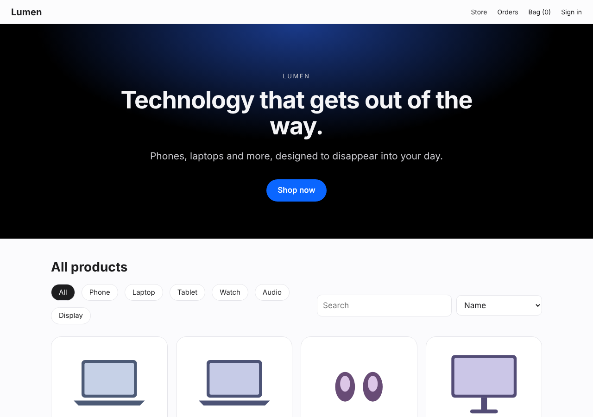
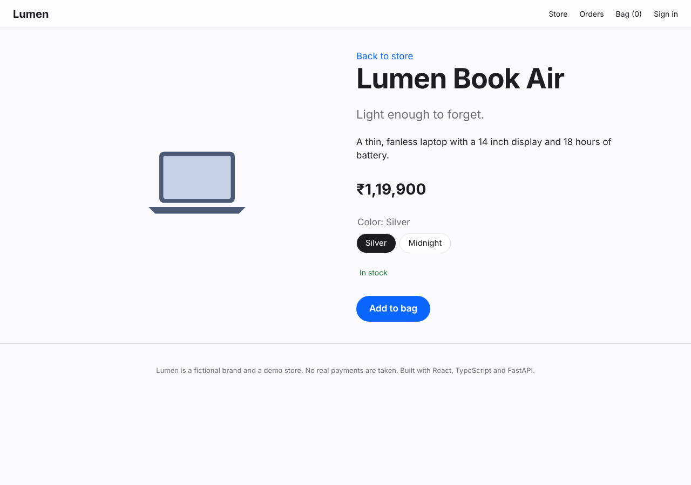
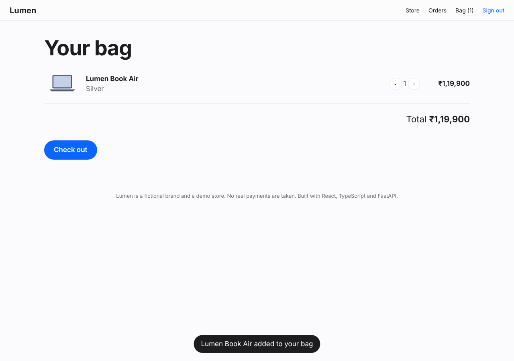

# Lumen Store

A full stack online store for a **fictional** device brand. Shoppers browse, search, filter and sort products, build a bag, sign in and place an order. The server decides every price and stock count.

> Lumen is an original demo brand. It is not affiliated with any real company, and it uses no real logos, product names or photos. No real payments are taken.





## Try it
1. Browse the store, filter by category, search and sort. These all run through the API.
2. Open a product, choose a color and add it to your bag.
3. Sign in with `demo@lumen.dev` / `demo123`, or create an account.
4. Check out with any 6 digit pincode, then see the order under **Orders**.

## What is built
| Area | Details |
|---|---|
| Catalog | Search, category filter, sorting, pagination, stock labels |
| Accounts | Register and sign in, PBKDF2 hashed passwords, signed expiring tokens, customer and admin roles |
| Bag | Colors, quantities (1 to 5), saved in the browser |
| Checkout | Client and server validation, demo payment, order history |
| Order safety | Prices come from the database, never the browser. Stock is decreased with one atomic conditional update so the last unit cannot be sold twice. An `Idempotency-Key` stops a double click from creating two orders |
| Privacy | A customer can only see their own orders |
| Admin | `PATCH /admin/products/{id}` to change stock, admin only |
| Operations | Consistent error format with correlation IDs, JSON logs, `/health`, Prometheus style `/metrics` |
| Accessibility | Skip link, labeled controls, keyboard friendly, visible focus, text alternatives for product art, reduced motion, dark mode |
| Quality | Backend 9 pytest tests at 99% coverage. Frontend 7 Vitest tests at about 99% line coverage. CI on every push |

## Not built yet
Real payments, product photos, reviews, email, refresh tokens, Alembic migrations. The Docker Compose file with PostgreSQL is included but was not run in the test environment, so only SQLite is verified.

## Run locally
```
cd backend && pip install -r requirements.txt && SEED_DEMO=1 python -m uvicorn app.main:app --reload
cd frontend && npm install && npm run dev
```
API docs at `http://localhost:8000/docs`. Tests: `pytest --cov=app` in `backend`, `npm test` in `frontend`.

## Deploy
- API on Render: root directory `backend`, build `pip install -r requirements.txt`, start `uvicorn app.main:app --host 0.0.0.0 --port $PORT`, variables `SECRET_KEY`, `SEED_DEMO=1`, `CORS_ORIGINS=<your Netlify URL>`.
- Frontend on Netlify: base directory `frontend`, build `npm run build`, publish `dist`, variable `VITE_API_URL=<your Render URL>`.

## Security note
The token lives in `sessionStorage` for simplicity. A production store would use httpOnly cookies.
